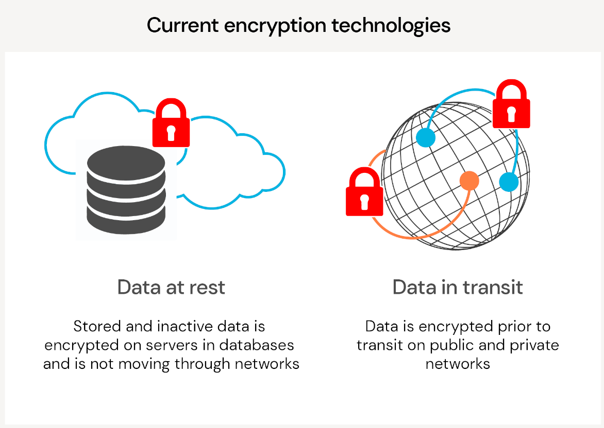

---
author:
  - Duncan Leggat
institute:
  - UCL ARC
date: 2026-12-03
title: Securing our Sensitive Data
subtitle: The demand for and challenges of Confidential Computing on High Performance Computing
---

## About the presenter

::::{.columns}
:::{.column width=40%}

:::

:::{.column width=60%}

- Duncan Leggat
- Former experimental particle physicist
- RSE in UCL Advanced Research Computing
  - Specialising in HPC,
  - GPU training,
  - Confidential computing.
:::

::::

# Analysing sensitive data

## What is sensitive data?

::::{.columns}

:::{.column width=40%}
Data that contains information that must not be unintentionally disclosed

:::{.nonincremental}
:::{.fragment fragment-index=1}
- Personal data that directly or indirectly identifies individuals
:::
:::{.fragment fragment-index=2}
- Medical or other protected category data
:::
:::{.fragment fragment-index=3}
- Environmental data
:::
:::{.fragment fragment-index=4}
- Sensitive IP
:::
:::

:::

:::{.column width=60%}

:::{.r-stack}
{.fragment fragment-index=1}

{.fragment fragment-index=2}

{.fragment fragment-index=3}

{.fragment fragment-index=4}
:::
:::
::::

:::{.fragment}
Anything you would store in a data safe haven, TRE, etc.
:::

## Using secure data

Current solutions for running on sensitive data:

- Anonymisation -> can't always guarantee against indirect identification,
- Analysing in a Trusted Research Environment (TRE) -> limited compute pool
- [other solution?]

:::{.fragment}
If we want to carry out intensive analyses, particular those with AI/ML workloads, we need to be able to process our sensitive data securely on HPC systems.
:::

# FRIDGE TRUSTEE project

[Placeholder for logos]

## Introduction to FRIDGE

Federated Research Infrastructure by Data Governance Extension (FRIDGE) can be thought of as portable TRE that can be deployed on HPC clusters

[Insert image that demonstrates this]

## Limits of FRIDGE

[Same image as previous slide]

- Relies on governance agreements with HPC provider.
- Though it would break the agreement, they *can* look at the data being analysed.
- For particularly sensitive data, therefore, this is not *enough* security.

:::{.fragment}
Is 
:::

# Introducing Confidential Computing

::: {.r-hstack}

:::{.fragment}

:::

:::	

## The Trusted Execution Environment (TEE)

:::{.fragment}
An attestable, hardware-based environment to protect data.
:::

:::{.fragment}
CCC defines a TEE as an environment that provides:

- Data integrity,
- Data confidentiality,
- Code integrity.

:::

A TEE is usually an 'enclave' or a Confidential Virtual Machine (CVM) that is cryptographically isolated from the rest of the system, including from the OS, the hypervisor and superusers.

## Vendor implementations of TEEs

[Table from intro talk or reproduction thereof?]

## Does our current HPC infrastructure support TEEs?

A lot of it does!

*AMD*

- SEV-SNP is part of EPYC 7003 (Milan) and onwards
- TEE Device Interface Security Protocol (TDISP) to integrate PCIe devices from 9005 (Turin) 

*Intel* 

- TDX was introduced in the 4th Gen Xeon (Sapphire Rapids)

*Nvidia*

- H100s and later offer CC modes
  - **Note:** Grace chips *aren't* compatible, so standalone Hoppers can run TEEs, but Grace Hoppers cannot!

## Can we turn on TEEs on a current, working HPC?

:::{.fragment}
No.
:::

## Difficulties in implementing TEEs on current HPC

Getting *one* TEE running is difficult

- BIOS updates
  - Not too difficult
 
- OS and kernel version
  - Rocky 9 uses Linux kernel []
  - Rocky 10 uses [] <- 
  - Much harder to implement at scale

Updating at scale is largely impossible

- HPC prioritises stability and up-time.
- Updating OS threatens both
  - Package management 

# Is there no hope for CC on HPC?

[sad face image]

## TEEs on future systems

## How we would implement TEEs on future HPC infrastructure

- Hardware must support TEEs
  - Not too difficult, most current-gen hardware now does in various forms
- Firmware must be configured correctly
  - Ensure BIOS settings to enable CCs are set correctly
- Chose an appropriate Operating System
  - By then, Rocky may fully support CC, or investigate alternatives [check alts]

## *Should* we implement them?

# Conclusions
