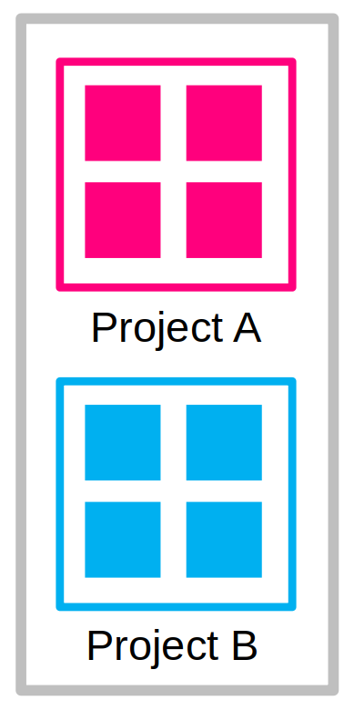
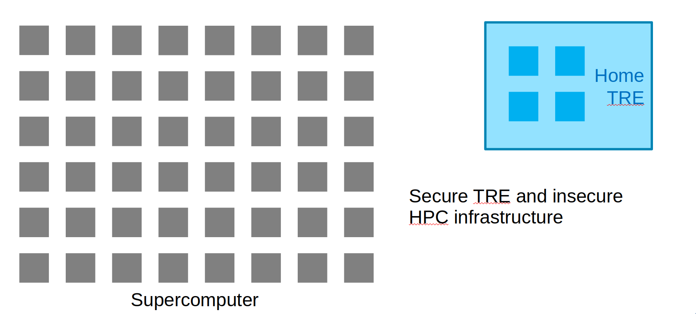
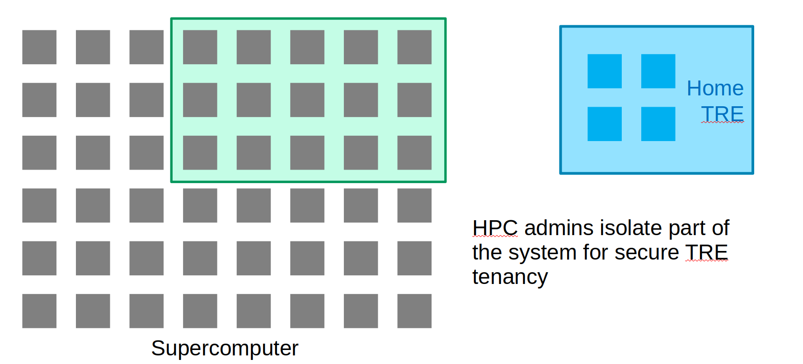
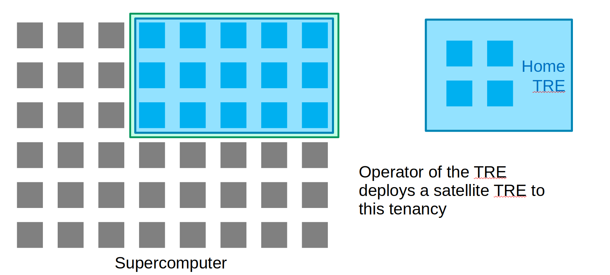
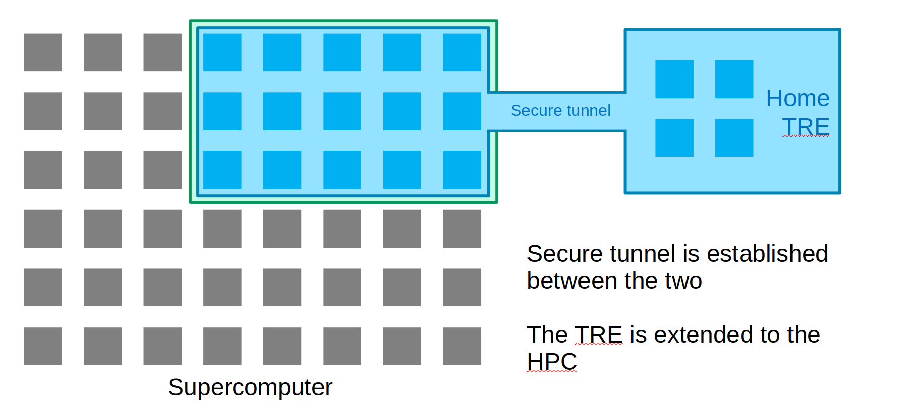
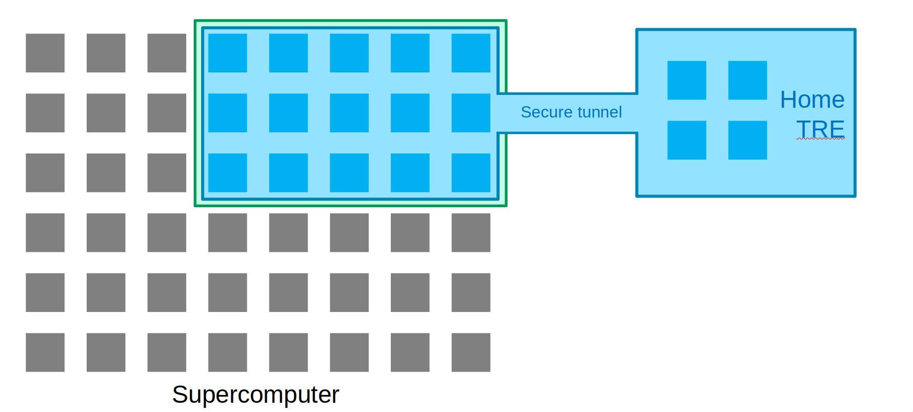
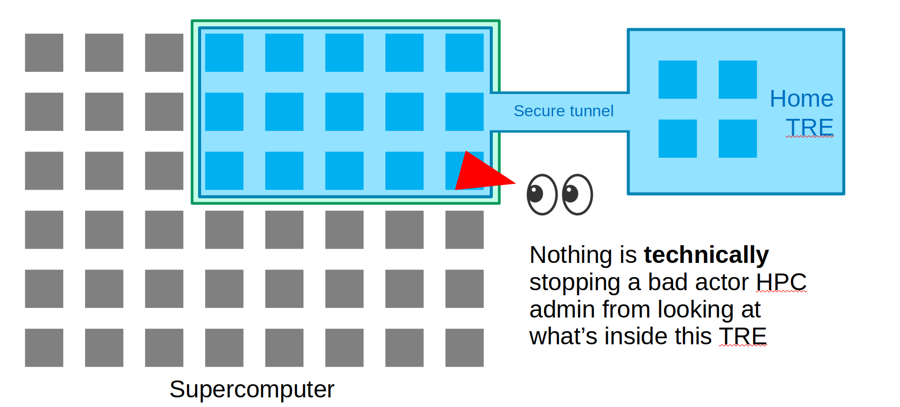
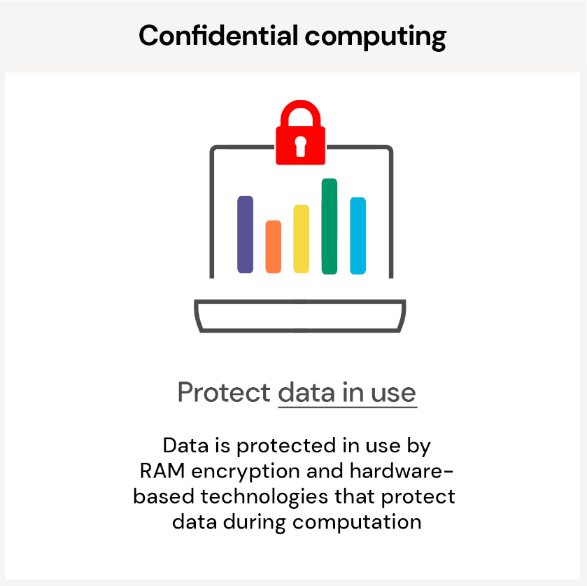
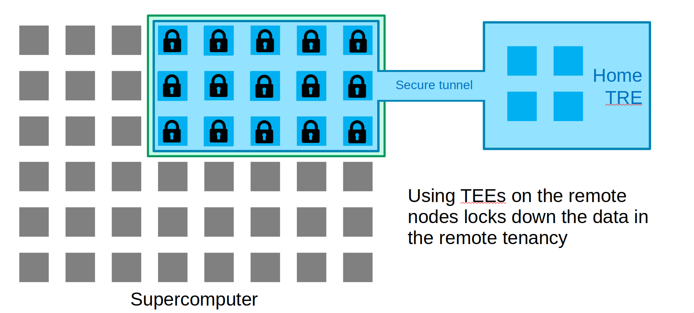
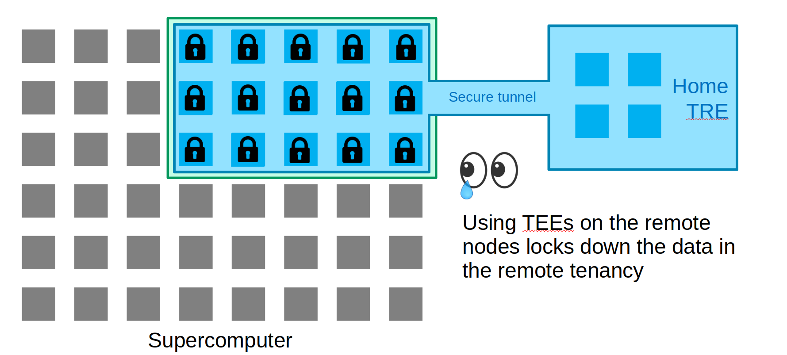

---
author:
  - Duncan Leggat
institute:
  - UCL ARC
date: 2026-12-03
title: Securing our Sensitive Data
subtitle: The demand for and challenges of Confidential Computing on High Performance Computing
---

## About the presenter

::::{.columns}
:::{.column width=40%}

:::

:::{.column width=60%}

- Duncan Leggat
- Former experimental particle physicist
- RSE in UCL Advanced Research Computing
  - Specialising in HPC,
  - GPU training,
  - Confidential computing.
:::

::::

# Analysing sensitive data

## What is sensitive data?

::::{.columns}

:::{.column width=40%}
:::{.fragment fragment-index=0}
Data that contains information that *must not* be unintentionally disclosed
:::

:::{.nonincremental}
:::{.fragment fragment-index=1}
- Personal data that directly or indirectly identifies individuals
:::
:::{.fragment fragment-index=2}
- Medical or other protected category data
:::
:::{.fragment fragment-index=3}
- Sensitive IP
:::
:::{.fragment fragment-index=4}
- Environmental data
:::
:::

:::

:::{.column width=60%}

:::{.r-stack}
{.fragment fragment-index=1}

{.fragment fragment-index=2 .fade-in-then-out}

{.fragment fragment-index=4}

{.fragment fragment-index=3 .fade-in-then-out}
:::

:::{.fragment fragment-index=1}
*Stock photos from Magnific*
:::

:::
::::

:::{.fragment}
Anything you would store in a data safe haven, TRE, etc.
:::

## Using secure data

::::{.columns}

:::{.column width=40%}
Current solutions:

:::{.fragment fragment-index=1}
**Anonymisation**
:::

:::{.nonincremental}
:::{.fragment fragment-index=2}
- Can't always guarantee against indirect identification
:::

:::{.fragment fragment-index=3}
- Not enough information left for some analyses
:::
:::

:::{.fragment fragment-index=4}
**Trusted Research Environment (TRE)**
:::

- Strict governance and technical controls

- Limited compute pool

:::

:::{.column width=60%}

:::{.r-stack}

{.fragment fragment-index=1 .fade-in-then-out}

{.fragment fragment-index=4 width=60%}

:::

:::

::::

:::{.fragment}
If we want to carry out intensive analyses, particular those with AI/ML workloads, we need to be able to process our sensitive data securely on HPC systems.
:::

# FRIDGE TRUSTEE project

[Placeholder for logos]

## Introduction to FRIDGE

:::{.r-stack}

{.fragment}

{.fragment}

{.fragment}
:::

Federated Research Infrastructure by Data Governance Extension (FRIDGE) can be thought of as portable TRE that can be deployed on HPC clusters

## Limits of FRIDGE

:::{.r-stack}

{.fragment fragment-index=2}
:::

:::{.nonincremental}
:::{.fragment fragment-index=1}
- Relies on governance agreements with HPC provider.
:::

:::{.fragment fragment-index=2}
- Though it would break the agreement, they *can* look at the data being analysed.
:::

:::{.fragment}
- For particularly sensitive data, therefore, this is not *enough* security.
:::
:::

# Introducing Confidential Computing

::: {.r-hstack}

:::{.fragment}

:::

:::	

## The Trusted Execution Environment

:::{.fragment}
An attestable, hardware-based environment to protect data.
:::

:::{.fragment}
CCC defines a TEE as an environment that provides:

- Data integrity,
- Data confidentiality,
- Code integrity.

:::

A TEE is usually an 'enclave' or a Confidential Virtual Machine (CVM) that is cryptographically isolated from the rest of the system, including from the OS, the hypervisor and superusers.

## TRUSTEE - adding TEEs to FRIDGE

:::{.r-stack}

{.fragment}

{.fragment}
:::

## Vendor implementations of TEEs

| Vendor | TEE technology | Generation implemented |
| ------ | -------------- | ---------------------- |
| Intel  | Trust Domain Extensions (TDX) | 4th gen (Sapphire Rapids) |
| AMD    | Secure Encrypted Virutalisation (SEV) | EPYC 7003 (Milan) onwards)
|        | TEE Device Interface Security Protocol (TDISP) | EPYC 9005 (Turin) onwards) |
| ARM    | Realm Management Extension (RME) | Optional from ARM v9 |
| Nvidia | GPU CC mode | Hopper and Blackwell GPUs [^1] |

:::{.fragment}
So this technology exists in current HPC infrastructure
:::

[^1]: **Note:** Grace chips *aren't* compatible, so standalone Hoppers can run TEEs, but Grace Hoppers cannot! 

## Can we turn on TEEs on a current, working HPC?

:::{.fragment}
We worked with the COSMA HPC sysadmins to see if we could deploy a TEE on a live HPC system.
:::
:::{.fragment}
**2 goals**
:::

- Create an SEV-SNP enabled CVM on an EPYC-based node,
- Deploying a CC-enabled TEE that included an H100.

:::{.fragment}
So it was a smooth process and we are now able to process sensitive data on HPCs, right?
:::

:::{.fragment}
*No.*
:::

## Difficulties in implementing TEEs on current HPC

::::{.columns}
:::{.column}
:::{.fragment}
Getting *one* TEE running is difficult
:::

:::{.fragment}
**BIOS settings**
:::

- CC not enabled by default in hardware
- Not too difficult to update
 
:::{.fragment}
**OS and kernel version**
:::

- Rocky and RHEL use stable LTS Linux kernels, which don't have full CC enabled
  
:::{.fragment}
| OS | Linux kernel | CC support? |
| -- | ------------ | ----------- |
| Rocky/RHEL 9 | 5.14 | No |
| Rocky/RHEL 10 | 6.12 | Technical preview |
:::
:::

:::{.column}

:::{.fragment}
Updating at scale is largely impossible
:::

- HPC prioritises stability and up-time.
- Updating OS threatens both:
  - A lot of work to check necessary packages on the new OS,
  - Updating hundreds of nodes puts a significant dent in up-time.
  
:::
::::

# Is there no hope for CC on HPC?

[sad face image]

## TEEs on future systems

:::{.fragment}
**How we would implement TEEs on future HPC infrastructure**
:::

- Hardware must support TEEs
  - Not too difficult, most current-gen hardware now does in various forms
- Firmware must be configured correctly
  - Ensure BIOS settings to enable CCs are set correctly
- Choose an appropriate Operating System
  - By then, Rocky may fully support CC, or investigate alternatives [check alts]

:::{.fragment}
** *Should* we implement them?**
:::

- That topic is outside the scope of this talk.

# Conclusions

[Thoughtful and relevant conclusions go here]
